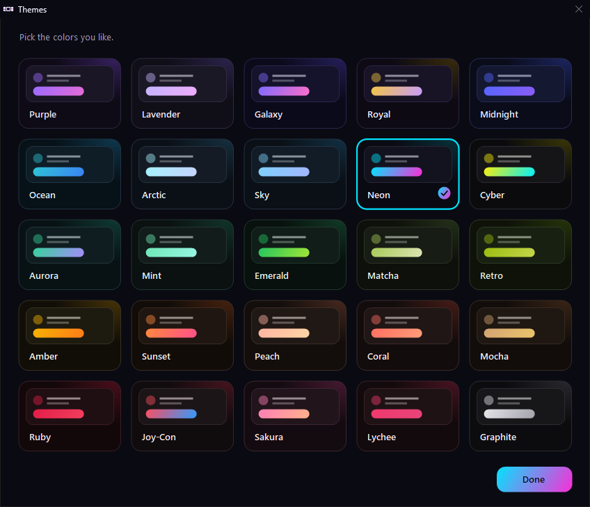

# 🎮 NS2 Emulator Manager

[](https://github.com/KaitonGxx/NS2-Emulator-Manager/releases/latest)
[](https://github.com/KaitonGxx/NS2-Emulator-Manager/releases)
[](LICENSE)
[](#-install)

Install, update and launch Switch 2 emulators on Windows, from one small window.

Tick the emulators you want and click Install. From then on, every update is one click, your saves stay where they
are, and you can go back to any older version whenever you like. It handles Eglantine Main, PokeDinner and Lichii out
of the box, and any other fork from a GitHub or Gitea link.

Made by **Riskbreak** (Discord).

> **AI disclosure:** NS2 Emulator Manager was written with Claude, Anthropic's AI assistant, under the direction of its
> maintainer, who tested the changes on Windows.


## ✨ Features

**📥 Install and update**
- **Installs** Eglantine Main, PokeDinner and Lichii, or any other fork from a GitHub or Gitea link.
- **Updates** with one click. The version you replace is kept, so you can go back.
- **Choose any version** from a list of every release (each card's "..." menu).
- **Finds emulators you already have**, so nothing is downloaded twice.
- **Updates itself** from this page when a new version is out, and shows what changed.

**💾 Your saves, kept safe**
- **Everything stays in the manager's folder:** each emulator it installs keeps its saves in its own folder, and the
  manager's own files are in `.manager-data`. The manager puts nothing in AppData. (An emulator you already had may still
  use AppData until you choose **Keep its saves in its own folder** in its "..." menu.)
- **Share data with other emulators:** tick it on one Switch 2 emulator and the others use its keys, firmware and saves,
  so your progress follows you. Saves for different games are combined, and nothing is deleted. When you stop, choose
  whether the others keep the latest saves or restore their own. (Not on FAT32 or exFAT drives, like most USB sticks:
  there each emulator keeps its own.)
- **Save Helper** shows where every emulator's saves are, the backups, and how to back them up.
- **Open any of its folders** (keys, firmware, saves, mods, screenshots) from each card's "..." menu.

**🎨 Make it yours**
- **25 themes** from the Themes button at the top.
- **Each emulator's own logo** on its card, or a picture of your choice.
- **Rename** any emulator from its card's "..." menu.

**🕹️ Switch 1 emulators too**
- Add Eden and other Switch 1 emulators like it (Citron, Sudachi...) from a link. Choose a **Switch 1 games folder** on
  the Games folder tile: they show only those games and skip your Switch 2 games, so their game list opens faster.
- They keep their own keys, firmware and saves (shared data is for Switch 2 emulators). Set to the wrong Switch? Change
  it with **Switch 1 or Switch 2...** in the card's "..." menu.

**🎒 Portable if you want it**
- A **no-install version** that keeps everything in one folder, for a USB stick, a games drive or a backup you can
  copy. See [Portable version](#-portable-version-no-install).

## 📸 Screenshots

| First start | Already have them? |
|:---:|:---:|
|  |  |
| **Choose any version** | **25 themes** |
|  |  |
| **No emulators yet** | **Setup** |
|  |  |

## 📲 Install

1. Go to [Releases](https://github.com/KaitonGxx/NS2-Emulator-Manager/releases/latest) and download the latest
   `NS2EmulatorManager.zip`.
2. Extract the whole zip (right-click it, then **Extract All**).
3. Run **Setup.exe** from the extracted folder.

It installs for your user only (no admin needed). Uninstall from **Settings > Apps**.

> [!TIP]
> **"Windows protected your PC"?** Click **More info**, then **Run anyway**. Windows shows this for new programs that
> aren't widely downloaded yet.

### 🎒 Portable version (no install)

Want to keep everything on a USB stick, a games drive, or in one folder you can copy? Download
`NS2EmulatorManager-Portable.zip` instead, extract it where you want it, and open **EmuManager.exe**.

It works just like the installed version. The differences:

- **Nothing is added to Windows:** no Apps & features entry, no shortcuts, no Uninstall. To remove it, delete its folder.
- **Every emulator stays inside its folder**, so copying the whole folder takes everything with it: to back it up or to
  use it on another PC. It finds its way again even if the drive letter changes.
- **Removed things** go to the folder's own `Removed items` folder (USB sticks have no Recycle Bin).
- **Updates itself** like the installed version, and still adds nothing to Windows.

> [!NOTE]
> **USB sticks formatted as FAT32 or exFAT** (most of them) can't share saves between emulators, so each one keeps its
> own. NTFS drives can. This applies to the installed version too.

> [!IMPORTANT]
> Keep `portable.txt` next to `EmuManager.exe`. It's what makes it portable.

## 🔑 Keys and firmware

> [!IMPORTANT]
> The emulators need keys and firmware **from your own Switch**. This tool doesn't download or include them.

Each emulator's card shows simple steps to add them. If an emulator closes right after you open it, the manager tries
to tell you why (missing keys or firmware, an old graphics driver...) and how to fix it.

## 🆘 Need help?

Open **Show log** (bottom right) and click **Copy for help**, then paste it on Discord. It has what's usually needed
to help you, and your Windows user folder is hidden.

## 🛠️ Build from source

Needs Windows and Python 3 (it uses the C# compiler that comes with Windows):

```
python manager.py build        # builds EmuManager.exe
python manager.py installer    # builds dist\NS2EmulatorManager.zip and dist\NS2EmulatorManager-Portable.zip
```

The icon is drawn from `src\icon.html`. To redraw it, run `python src\make_icon.py`, which needs Microsoft Edge and Pillow.

## 🙏 Credits

- The emulators are made and hosted by their own projects:
  [Eglantine](https://github.com/Eglantine-Community/Eglantine),
  [PokeDinner](https://git.eden-emu.dev/Franseven/PokeDinner-a-Eglantine-Fork),
  [Lichii](https://github.com/zortos293/Lichii).
  This tool only downloads their official releases.
- The emulator logos on the cards belong to their projects: Eglantine's flower (PokeDinner's badge adds a ball to it)
  and Lichii's lychee.

## 📜 License

NS2 Emulator Manager is free software, released under the [GNU General Public License v3.0](LICENSE).

It isn't affiliated with or endorsed by Nintendo or any of the emulator projects above.
