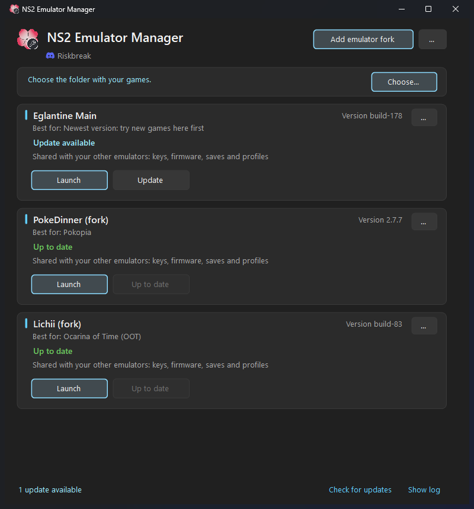
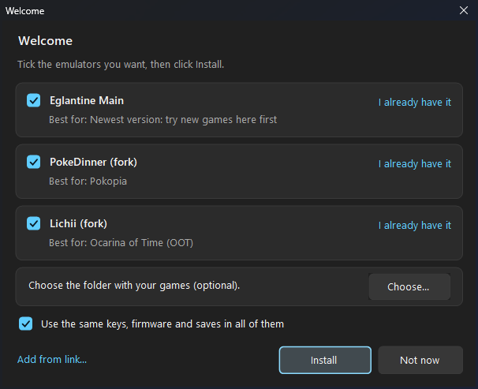
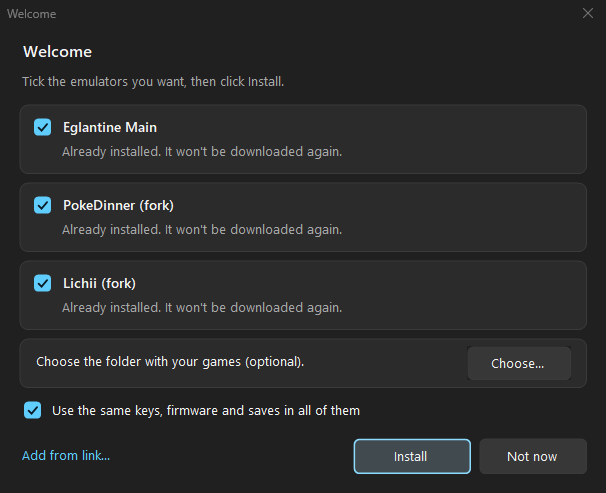
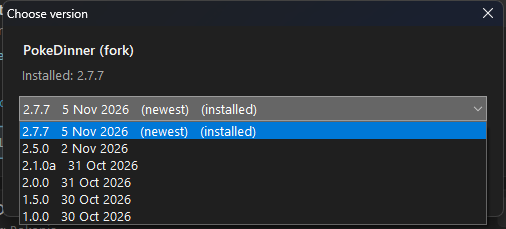
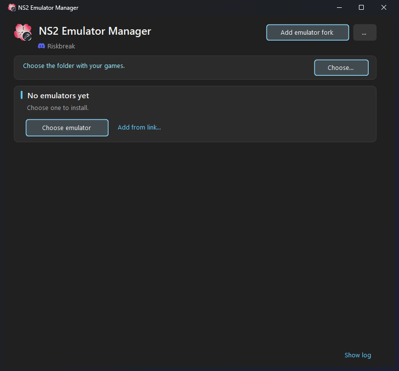
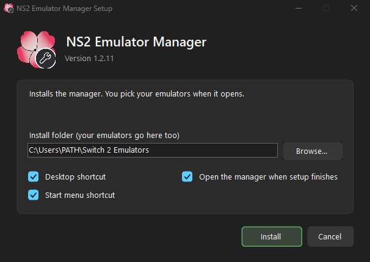

# NS2 Emulator Manager

Install, update and launch Switch 2 emulators on Windows, from one small window.

Made by **Riskbreak** (Discord).



## What it does

- **Installs** Eglantine Main, PokeDinner and Lichii, or any other fork from a GitHub or Gitea link.
- **Updates** with one click. The version you replace is kept, so you can go back.
- **Choose any version** from a list of every release (each card's "..." menu).
- **Keeps your saves safe.** Each emulator uses its own folder; nothing goes in `%APPDATA%`.
- **Shares keys, firmware and saves** between your emulators if you want (one tick box).
- **Finds emulators you already have**, so nothing is downloaded twice.

## Screenshots

**First start:** tick the emulators you want, then click Install.



**Already have them?** Emulators that are already in the folder are added without downloading them again.



**Choose any version** from each emulator's "..." menu.



**No emulators yet:** one click to pick some.



## Install



1. Go to [Releases](../../releases) and download the latest `NS2EmulatorManager.zip`.
2. Extract the whole zip (right-click it, then **Extract All**).
3. Run **Setup.exe** from the extracted folder.

It installs for your user only (no admin needed). Uninstall from **Settings > Apps**.

## Keys and firmware

The emulators need keys and firmware **from your own Switch**. This tool doesn't download or include them.
Each emulator's card shows simple steps to add them.

## Build from source

Needs Windows and Python 3 (it uses the C# compiler that comes with Windows):

```
python manager.py build        # builds EmuManager.exe
python manager.py installer    # builds dist\NS2EmulatorManager.zip (Setup.exe + EmuManager.exe)
```

## Credits

- The emulators are made and hosted by their own projects:
  [Eglantine](https://github.com/Djihads80/Eglantine),
  [PokeDinner](https://git.eden-emu.dev/Franseven/PokeDinner-a-Eglantine-Fork),
  [Lichii](https://github.com/zortos293/Lichii).
  This tool only downloads their official releases.
- The app icon is based on Eglantine's flower logo.

## License

GPL-3.0. See [LICENSE](LICENSE).
